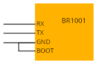

# Barrot Tools

Tooling for interacting with Barrot Bluetooth chips. Every supported command
has been documented by reverse engineering ROM and firmware.
Command definition done with [Scapy](https://scapy.net/). USB HCI transport implemented with
[usbbluetooth](https://usbbluetooth.github.io/).

## Interfaces

| Interface | Transport | CLI | Chips | Docs |
|-----------|-----------|-----|-------|------|
| ROM bootloader | UART | `br1001` | BR1001 | [doc/br1001](doc/br1001/Communication.md) |
| HCI VSC | USB | `br-hci` | BR8051, BR8551, ... | [doc/hci_vsc](doc/hci_vsc/Communication.md) |


## Install

```sh
pip install -e .
```

Dependencies: `pyserial`, `scapy`, `usbbluetooth`.

---

## BR1001 bootloader (`br1001`)

The BR1001 ROM bootloader is reachable over UART. To enter it, power up with the
BOOT pin pulled to GND and connect UART RX/TX at 115200 baud.



```
br1001 -d <device> <command> [args]
```

| Command | Args | Description |
|---------|------|-------------|
| `info` | — | Probe flash: magic, JEDEC id, security registers |
| `partitions` | — | List flash partitions (addr/length) |
| `flash_dump` | `file` | Dump the full flash (512 KB) to file |
| `bootloader_dump` | `file` | Dump the bootrom region to file |
| `sram_dump` | `file` | Dump SRAM to file |
| `mem_read` | `addr size file` | Read a memory/flash region to file |
| `mem_write` | `addr hex [--file]` | Write hex bytes (or a file) to an address |
| `partition_dump` | `part file` | Dump a partition to file |
| `cfg` | `[--part]` | Dump the ROM cfg store (partition 0x62) |
| `flash_erase` | — | Erase the whole flash |

```sh
br1001 -d /dev/ttyUSB0 flash_dump flash.bin
br1001 -d /dev/ttyUSB0 mem_read 0x20000000 0x1000 sram.bin
br1001 -d /dev/ttyUSB0 mem_write 0x20000000 deadbeef
```

---

## Barrot HCI (`br-hci`)

Barrot chips expose a vendor-specific HCI command set over USB (`0xFC80`). The
device is auto-detected across known Barrot USB ids (`0x33fa:0x0010`,
`0x33fa:0x0012` — extend `BARROT_USB_IDS` to add more).

```
br-hci [-v] <command> [args]
```

| Command | Args | Description |
|---------|------|-------------|
| `info` | — | Print chip model + version info |
| `signature` | — | Print the chip signature |
| `bd_addr` | `[mac]` | Read the BD address, or set it (RAM only) |
| `reset` | `[type]` | Reset the chip (`hw`/`rom`/`sw`/`sw_patch`/`hci`) |
| `flash_dump` | `file` | Dump the full flash (512 KB) to file |
| `flash_read` | `addr size file` | Read a flash region to file |
| `flash_write` | `addr file` | Write a file to flash |
| `flash_erase` | `addr length` | Erase a flash region |
| `rom_dump` | `file` | Dump the 256 KB mask ROM to file |
| `ram_dump` | `file` | Dump the 128 KB SRAM to file |
| `bus_read` | `addr size [file]` | Read memory via BUS_READ |
| `bus_write` | `addr (--hex\|--file)` | Write memory via BUS_WRITE |
| `eeprom_read` | `addr size [file]` | Read EEPROM (may be unsupported) |
| `eeprom_write` | `addr (--hex\|--file)` | Write EEPROM (may be unsupported) |
| `param_read` | `tag length` | Read a parameter-store tag |
| `param_write` | `tag hex` | Write a parameter-store tag |
| `config_read` | `--tag [file]` | Read a single config tag |
| `config_dump` | `[--addr --size]` | Read and pretty-print the NVDS partition |
| `rf_reg_read` | `addr` | Read an RF register |
| `rf_reg_write` | `addr value` | Write an RF register |
| `rf_freq_trim` | `[hex]` | Read/write RF crystal trim (6 B) |
| `uart_tl_param` | `[hex]` | Read/write UART transport-layer params (18 B) |
| `patch_test` | — | Run the chip patch-test routine |
| `patch_end` | `enable` | Toggle the patch-override flag |

`addr`, `size`, `length`, and `value` accept hex (`0x…`) or decimal.

```sh
br-hci info
br-hci bd_addr 00:11:22:33:44:55 # Set the BD_ADDR (non-persistent)
br-hci flash_dump flash.bin
br-hci bus_read 0x20000544 0x80 cmd_tab.bin
br-hci -v info        # show raw HCI packets
```

See [doc/hci_vsc/Communication.md](doc/hci_vsc/Communication.md) for the full
command table and safety notes (some commands can brick or hang the chip).

---

## Python API

Both drivers share the same shape: a transport, a `pkt` module of scapy
packets, and a driver class with high-level `noun_verb` methods.

```python
from barrot_tools.br1001.br1001 import BR1001
from barrot_tools.brt_hci_spec.brt_hci_spec import BrtHciSpec

with BrtHciSpec() as chip:
    print(chip.chip_info())            # human-readable
    print(chip.chip_info().model)      # "BR8051A02" / "BR8551A01" / ...
    chip.flash_dump(0x00000000, 0x80000, "flash.bin")
    addr, value = chip.rf_reg_read(0xaa)

with BR1001("/dev/ttyUSB0") as br:
    br.init()
    br.flash_dump("flash.bin")
```

Drop down to raw packets through `chip.sr1()` and the classes in each
`pkt` module when you need a command the driver does not wrap:

```python
from barrot_tools.brt_hci_spec.pkt import HCI_Cmd_VSC_Barrot, HCI_Cmd_VSC_Barrot_Bus_Read, BRT_HCI_VSC_CMD_ID

with BrtHciSpec(verbose=True) as chip:
    resp = chip.sr1(HCI_Cmd_VSC_Barrot(cmd=BRT_HCI_VSC_CMD_ID.BUS_READ) /
                    HCI_Cmd_VSC_Barrot_Bus_Read(address=0x20000000, length=16))
    resp.show()
```

---

## TODO

- Implement patching for flash writes on HCI (`br-hci`): `flash_write`/`flash_erase`
  return success but are silent no-ops until the flash is unlocked via a RAM patch
  (WRITE_PATCH + SW_PATCH reset).
- BR1001 ROM code implement FOTA upgrades via BLE service. Reverse and implement.

---

## Contributing

Pull requests and issues are welcome.
